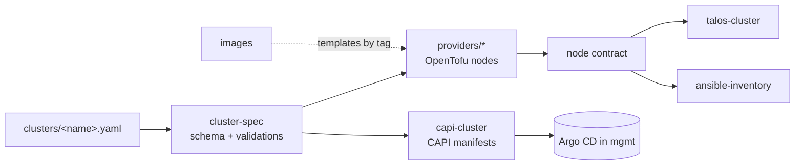

# modules

OpenTofu modules and generators of the sogeor cluster constructor.

[](https://github.com/sogeor/modules/actions/workflows/validate.yml)
[](https://github.com/sogeor/modules/actions/workflows/docs.yml)
[](https://scorecard.dev/viewer/?uri=github.com/sogeor/modules)
[](LICENSE)

> **Status:** the cluster description is ready: [schema](schemas/cluster.schema.json),
> [`cluster-spec`](modules/cluster-spec/README.md), [reference clusters](clusters/) and
> [policies](policies/conftest/cluster/cluster.rego); Proxmox VE nodes:
> [`providers/proxmox`](modules/providers/proxmox/README.md). Other modules follow, see [ROADMAP.md](ROADMAP.md).

## Overview

- **One cluster description** (YAML) is the input of every mechanism: distribution, topology, profiles and node pools.
- **Validation before any resource exists:** OS × distribution, image per (OS, provider), control plane size for `ha`, budget limits.
- **Provider modules** create nodes and return one normalized node contract, so nothing above them knows the provider.
- **Two mechanisms, one interface:** OpenTofu for the first (management) cluster and static nodes, Cluster API manifests for workload clusters.
- **Topology `single` or `ha`** is a configuration value, not a code change.



## Quick start

```bash
git clone https://github.com/sogeor/modules.git && cd modules
tools/install-tools.sh "$HOME/.local/bin"
tools/check-modules.sh
conftest test --policy policies/conftest/cluster --data modules/cluster-spec/matrix.yaml clusters/
```

Modules are consumed by tag from root modules in other repositories:

```hcl
module "spec" {
  source = "git::https://github.com/sogeor/modules.git//modules/cluster-spec?ref=modules-v0.1.0"
}
```

Details: [Getting started](docs/getting-started.md).

## Documentation

| Page | What is inside |
|---|---|
| [Overview](docs/index.md) | Purpose, place in the platform, module catalog |
| [Getting started](docs/getting-started.md) | Tools, local checks, consuming a module |
| [Repository setup](docs/setup.md) | GitHub settings, ruleset, Renovate, Scorecard |
| [Configuration](docs/configuration.md) | Every option: cluster description, module inputs, CI |
| [Usage](docs/usage.md) | Typical tasks |
| [Operations](docs/operations.md) | Releases, updates, lock files |
| [Architecture](docs/architecture.md) | Constructor, mechanisms, contracts |
| [Security](docs/security.md) | Guarantees, limits, assurance case |
| [Troubleshooting](docs/troubleshooting.md) | Symptoms, causes and fixes |
| [Decisions](docs/adr/index.md) | Architecture decision records |

Preview locally: `pip install --require-hashes -r .github/requirements-docs.txt && mkdocs serve`.

## Supported matrix

| Distribution | OS | Proxmox VE | Selectel (OpenStack) | BYO | Status |
|---|---|---|---|---|---|
| Talos | talos | nodes: ready (OpenTofu); cluster: planned; CAPI: planned | planned (CAPI) | planned | in progress |
| kubeadm | ubuntu-2404, ubuntu-2604 | nodes: ready (OpenTofu, ubuntu-2404); CAPI: planned | planned (CAPI) | planned | in progress |
| kubeadm | astra-18 | planned (CAPI) | — | planned | planned |
| k3s | ubuntu, astra-18, alpine | — | — | — | later |

## Versions

| Component | Version |
|---|---|
| OpenTofu | 1.13.1 (modules require ≥ 1.10.0) |
| `bpg/proxmox` | 0.116.0 |
| tflint | 0.64.0 |
| Conftest | 0.71.1 |
| terraform-docs | 0.24.0 |
| check-jsonschema | 0.38.2 |
| JSON Schema | draft 2020-12 |
| sogeor/workflows (`security-lite`, `docs`, `scorecard`) | v0.1.1 |
| actions/checkout | v7.0.1 |
| actionlint | 1.7.12 |
| yamllint | 1.38.0 |
| zizmor | 1.30.1 |
| gitleaks (pre-commit) | 8.30.1 |
| markdownlint-cli2 (pre-commit) | 0.23.3 |
| pre-commit-hooks | 6.0.0 |
| shellcheck (pre-commit) | 0.11.0 |
| mkdocs-material | 9.7.7 |

Python tools are locked with hashes (`*.in` → `*.txt` by pip-compile): `.github/requirements-lint.txt`,
`.github/requirements-docs.txt`. Regeneration: [Operations](docs/operations.md#update-locked-python-dependencies).

## Contributing

See [CONTRIBUTING.md](CONTRIBUTING.md). Governance: [GOVERNANCE.md](GOVERNANCE.md).
Plans: [ROADMAP.md](ROADMAP.md). Conduct: [CODE_OF_CONDUCT.md](CODE_OF_CONDUCT.md).
Changes: [CHANGELOG.md](CHANGELOG.md).

## Security

Report vulnerabilities privately as described in [SECURITY.md](SECURITY.md).
What the modules guarantee: [docs/security.md](docs/security.md).

## License

[Apache-2.0](LICENSE)
