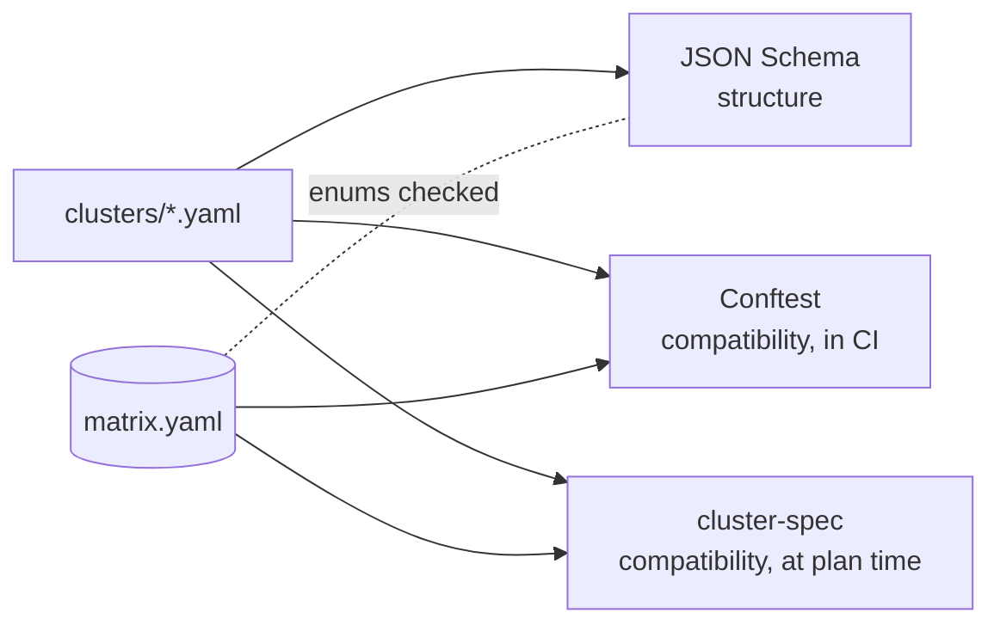
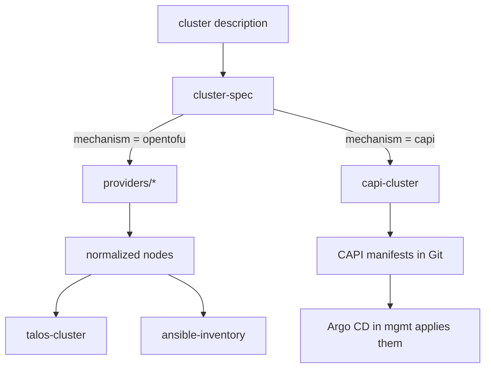
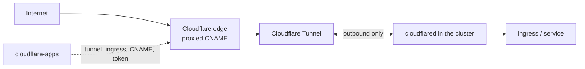

# Architecture

## Constructor

A cluster is assembled from independent axes:

```text
cluster = distribution + kubernetes_version + topology + profiles + network
pool    = role + os + provider + size + (count | autoscale) + labels + taints
```

The distribution is chosen per cluster (nodes join with the tools of the control plane);
the OS is chosen per pool, so a kubeadm cluster may mix OS across pools.

| Distribution | Allowed pool OS |
|---|---|
| `talos` | `talos` |
| `kubeadm` | `ubuntu-2404`, `ubuntu-2604`, `astra-18` |
| `k3s` | `ubuntu-2404`, `ubuntu-2604`, `astra-18` |

## Validation layers



- **JSON Schema** rejects unknown fields, wrong types and values outside the enums.
- **Conftest** and **cluster-spec** apply the same rules with the same ids, reading the same matrix. Conftest
  checks descriptions in pull requests without OpenTofu; `cluster-spec` stops a plan in the consuming repository.
- Planned images differ on purpose: Conftest warns, `cluster-spec` fails unless `allow_planned_images = true`,
  so reference descriptions can exist before their images while deployment still needs a real image.

## Data flow



## Public edge

`dns-records` and `cloudflare-apps` are independent of the cluster description: they take Cloudflare IDs and
hostnames from the consuming root module in `management`.



The cluster opens no inbound ports: `cloudflared` keeps outbound connections to Cloudflare. Only Tunnel and DNS
are used, no Access, WAF or WARP. Internal names (`lab` subdomain) are served by split DNS in the mesh, not by
public records.

## Two mechanisms, one interface

| Mechanism | When | Output |
|---|---|---|
| Cluster API | Provider with an API and a CAPI provider (workload clusters) | `Cluster`, control plane, `MachineDeployment`, `MachineHealthCheck`, Cluster Autoscaler bounds |
| OpenTofu | The management cluster, static and BYO nodes, providers without CAPI | VMs or registered nodes → Talos machine configuration or Ansible inventory |

Both take the same cluster description and expose the same node contract. A Cluster API cluster keeps all pools
on one provider (rule `capi-single-provider`, [ADR 0006](adr/0006-capi-manifests.md)); k3s is created only by
OpenTofu.

## Contracts

### Normalized node

Every provider module returns a map of nodes with these attributes:

| Attribute | Type | Description |
|---|---|---|
| `name` | string | Hostname, unique in the organization |
| `fqdn` | string | `<name>.<internal domain>` |
| `cluster` | string | Cluster name |
| `distribution` | string | `talos`, `kubeadm` or `k3s` |
| `role` | string | `control-plane`, `worker`, `edge`, `db` or `lb` |
| `pool` | string | Pool name |
| `provider` | string | Provider name |
| `site` | string | Site |
| `os` | string | Pool OS |
| `private_ip` | string | Private address |
| `public_ip` | string or null | Public address |
| `ssh_user` | string or null | `null` for Talos |
| `labels` | map(string) | Including `topology.kubernetes.io/region` and `zone` |
| `taints` | list(string) | Node taints |
| `mesh_required` | bool | `true` when the site is not `home` |

### Inventory

`ansible-inventory` creates `ansible_host` and `ansible_group` resources (`ansible/ansible` provider) with groups
`cluster_<name>`, `distribution_<d>`, `role_<role>`, `site_<site>`, `os_<os>`, `mesh`, `internet`.
Talos nodes are not included.

### Images

Provider modules select the newest image by tags (Proxmox: `packer;<os>;<kind>;…;v<build>`) or by
image family (`sogeor-<os>-<kind>`), as published by [images](https://github.com/sogeor/images).
New images do not replace existing nodes.

## Topology

| | `single` | `ha` |
|---|---|---|
| Control plane nodes | 1, workloads allowed on it | 3 (odd, at least 3) |
| Cluster API `MachineHealthCheck` | workers | workers and control plane |
| Cluster API API endpoint | Proxmox: VIP; OpenStack: floating IP | Proxmox: VIP; OpenStack: load balancer |

## Decisions

See [Decisions](adr/index.md), in particular [0002 Repository layout](adr/0002-repository-layout.md) and
[0003 Cluster description validation](adr/0003-cluster-description-validation.md) and
[0006 Cluster API manifests](adr/0006-capi-manifests.md).
Platform-wide decisions (constructor, Cluster API, topology) are in the [docs](https://github.com/sogeor/docs) repository.
