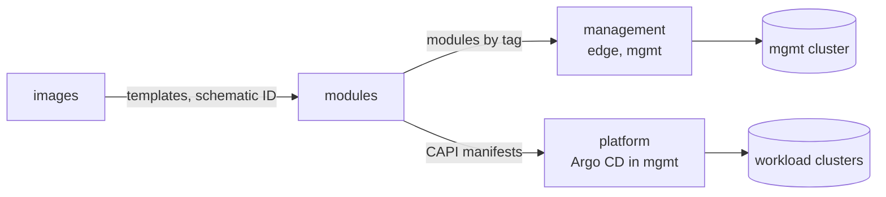

# sogeor modules

OpenTofu modules and generators of the cluster constructor of the [sogeor platform](https://github.com/sogeor).
A cluster is described once in YAML; the modules validate the description, create nodes on a provider
and produce either a Talos cluster, an Ansible inventory or Cluster API manifests from it.

!!! note "Status"
    The repository contains the scaffold, CI and documentation. Modules are added one per release in the
    order of the [module catalog](#module-catalog).

## Who this is for

- **Platform operators** who create the management cluster and workload clusters.
- **Engineers adopting the platform** who want the same constructor with their own providers and values.
- **Reviewers** who want to see how provider independence and validation before creation are implemented.

## Module catalog

| Module | Purpose | Status |
|---|---|---|
| `schemas/cluster.schema.json` | JSON Schema of the cluster description | planned |
| `modules/cluster-spec` | Reads and validates a description, compatibility matrix, derived values (CIDR, sizes) | planned |
| `modules/providers/proxmox` | Nodes on Proxmox VE from tagged templates or Talos images | planned |
| `modules/talos-cluster` | Talos Linux cluster through `siderolabs/talos` | planned |
| `modules/providers/byo` | Registration of existing servers | planned |
| `modules/ansible-inventory` | Ansible inventory from node contracts | planned |
| `modules/capi-cluster` | Cluster API manifests from a description | planned |
| `modules/providers/selectel` | Selectel networks and projects for cloud clusters | planned |
| `modules/mesh-registration` | Headscale pre-auth keys | planned |
| `modules/dns-records`, `modules/cloudflare-apps` | DNS records and Cloudflare Tunnel hostnames | planned |
| `clusters/*.yaml` | Reference descriptions `mgmt`, `main`, `talos` | planned |
| `policies/conftest` | Policies for descriptions and plans | planned |

## Place in the platform

| Repository | Relation |
|---|---|
| [images](https://github.com/sogeor/images) | Provides VM templates and the Talos schematic that provider modules select |
| `management` (planned) | Root modules with state that call these modules for `edge` and `mgmt` |
| `platform` (planned) | Argo CD applies the Cluster API manifests to the management cluster |
| [workflows](https://github.com/sogeor/workflows) | Reusable CI used by this repository |
| [docs](https://github.com/sogeor/docs) | Platform-wide decisions and guides |

## Where to start

| Goal | Page |
|---|---|
| Run the checks locally | [Getting started](getting-started.md) |
| Set up a fork | [Repository setup](setup.md) |
| Look up an option | [Configuration](configuration.md) |
| Typical tasks | [Usage](usage.md) |
| Release and update | [Operations](operations.md) |
| Understand the design | [Architecture](architecture.md), [Decisions](adr/index.md) |
| Security guarantees | [Security](security.md) |
| Fix a failure | [Troubleshooting](troubleshooting.md) |
